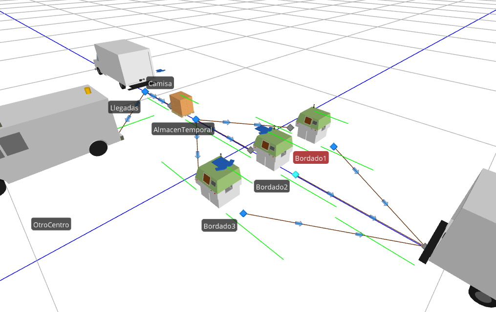
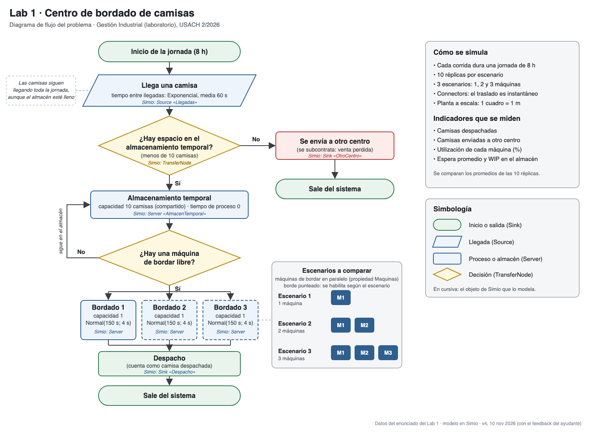
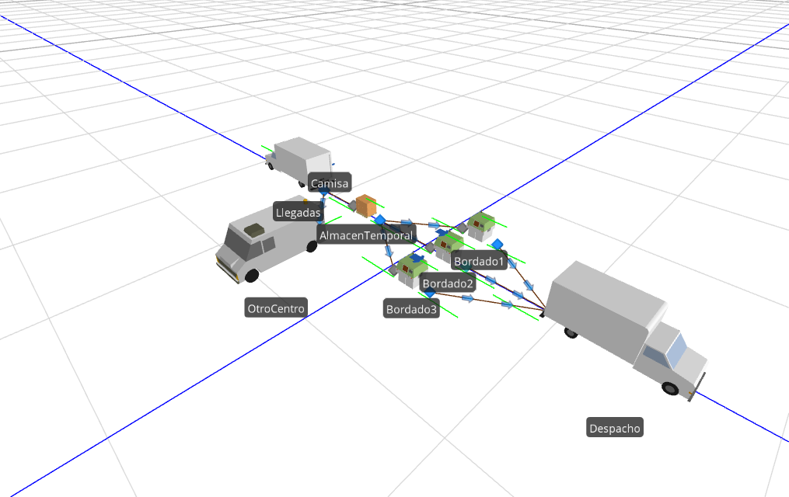
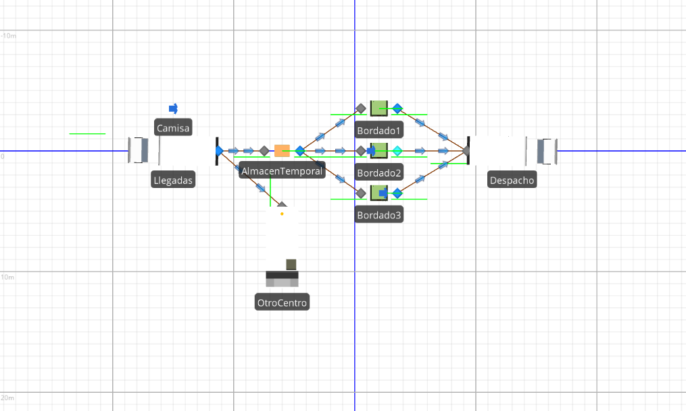
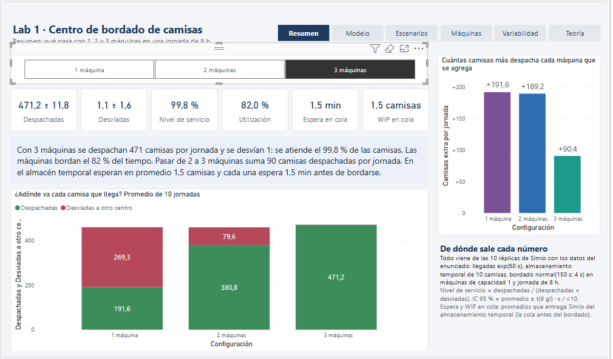
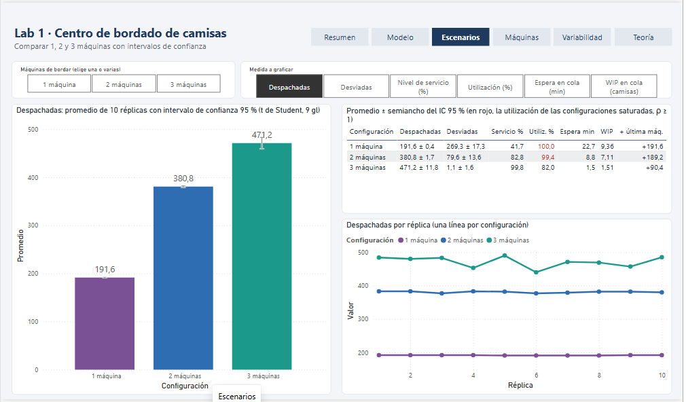
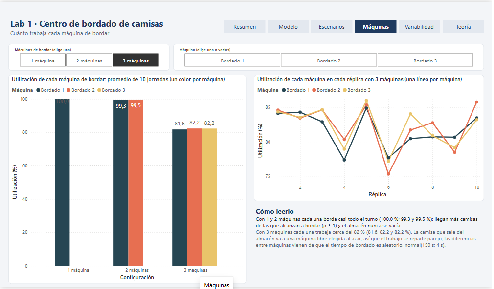

# Centro de bordado de camisas: simulación en Simio y tablero en Power BI

¿Cuántas máquinas de bordar necesita un taller para no perder ventas? Este proyecto lo responde con un modelo de simulación de eventos discretos en **Simio** (vista 3D, 30 réplicas) y un tablero en **Power BI** que compara 1, 2 y 3 máquinas.

Laboratorio 1 de Gestión Industrial · Ingeniería Civil Mecatrónica, USACH · 2.º semestre 2026.



## El problema

Un taller textil recibe camisas para bordarlas.

- Las camisas llegan con tiempos entre llegadas **exponenciales de media 60 s**.
- Esperan en un **almacenamiento temporal de 10 camisas**. Si está lleno, la camisa se manda a **otro centro de bordado**: para el taller es una venta perdida.
- El **bordado** dura una **normal de media 150 s y desviación 4 s**.
- Se simula una **jornada de 8 horas**. Se mide cuántas camisas se despachan, cuántas se van al otro centro, la utilización de las máquinas, la espera y el trabajo en proceso (WIP) en el almacén.
- Escenarios: la situación actual con **1 máquina** y lo que pasa al agregar **una o dos más**.

La cuenta a mano ya anticipa el resultado: llega una camisa cada 60 s y bordar una toma 150 s, así que hace falta el trabajo de 150/60 = **2,5 máquinas**. Con 1 o 2 la cola se llena; con 3 cada máquina debería estar ocupada cerca de 2,5/3 = 83 % del tiempo.

## Resultados

Promedio de 10 réplicas por escenario (30 corridas de 8 h), con intervalo de confianza del 95 %:

| Bordadoras | Despachadas | Enviadas a otro centro | Nivel de servicio | Utilización | Espera en el almacén | WIP en el almacén |
|---|---|---|---|---|---|---|
| 1 | 191,6 ± 0,4 | 269,3 ± 17,3 | 41,6 % | 100 % | 22,7 min | 9,4 camisas |
| 2 | 380,8 ± 1,7 | 79,6 ± 13,6 | 82,7 % | 99,4 % | 8,8 min | 7,1 camisas |
| 3 | 471,2 ± 11,8 | 1,1 ± 1,6 | 99,8 % | 82,0 % | 1,5 min | 1,5 camisas |

- Nivel de servicio = despachadas / (despachadas + enviadas a otro centro).
- Intervalo de confianza = promedio ± t(9 gl) · s / √10.
- Con 3 máquinas, la utilización de cada una es 81,6 %, 82,2 % y 82,2 %; el 82,0 % es su promedio.
- Las 30 réplicas están en [`datos/resultados_30_replicas.csv`](datos/resultados_30_replicas.csv).

## Conclusión

**Con 3 bordadoras el taller atiende el 99,8 % de las camisas: se pierde en promedio una por jornada.** Cada máquina queda ocupada el 82 % del tiempo, lo mismo que daba la cuenta a mano (83 %), y la espera en el almacén baja de 22,7 min a 1,5 min.

- Con 1 máquina se pierde más de la mitad de las camisas (269 de 461) y la máquina nunca para.
- Con 2 máquinas todavía se pierde el 17 % y las dos trabajan al 99 %: siguen siendo el cuello de botella.
- Pasar de 2 a 3 máquinas suma 90 camisas despachadas por jornada y deja un 18 % de holgura para absorber la variabilidad de las llegadas.

## El modelo



| Objeto en Simio | Qué representa | Cómo está configurado |
|---|---|---|
| `Llegadas` (Source) | Camión que trae las camisas | Tiempo entre llegadas `Random.Exponential(60)` s |
| Nodo de salida de `Llegadas` | Decisión «¿hay espacio en el almacén?» | Peso de enlace: al almacén si `AlmacenTemporal.Capacity.Remaining > 0`; si no, a `OtroCentro` |
| `AlmacenTemporal` (Server) | Almacenamiento temporal compartido | Capacidad 10, tiempo de proceso 0, sin buffers |
| `Bordado1`, `Bordado2`, `Bordado3` (Server) | Máquinas de bordar en paralelo | Capacidad 1, `Random.Normal(150, 4)` s; `Bordado2` y `Bordado3` se activan con el parámetro `Maquinas` |
| Salida del almacén | Espera de una máquina libre | Una camisa sale solo si hay una bordadora libre y elige al azar entre las disponibles |
| `Despacho` (Sink) | Camión de despacho | Cuenta las camisas despachadas |
| `OtroCentro` (Sink) | Camión hacia el otro centro | Cuenta las camisas desviadas |

- Los objetos están unidos con Connectors (traslado instantáneo) y la planta está a escala: cada cuadro de la cuadrícula mide 1 m.
- Las colas de las máquinas y del almacén se dibujan sobre cada objeto, así que en 3D se ve qué camisa se está bordando en cada máquina.

### Cómo se simulan 1, 2 y 3 máquinas

El modelo tiene **un parámetro, `Maquinas`**, que el enunciado sugiere como «equipo activo o inactivo». La capacidad de `Bordado2` es `Math.If(Maquinas >= 2, 1, 0)` y la de `Bordado3` es `Math.If(Maquinas >= 3, 1, 0)`. Así, el mismo archivo contiene los tres casos y ninguno se pierde al probar otro.

- **Para los números:** el experimento `Escenarios` corre `Maq1`, `Maq2` y `Maq3` con 10 réplicas de 8 h cada uno.
- **Para la animación:** en la ventana de navegación se elige `Model`, en sus propiedades se cambia *Controls › Maquinas* a 1, 2 o 3, y se aprieta Run.

## Capturas

| Vista 3D completa | Vista en planta corriendo |
|---|---|
|  |  |

El tablero de Power BI tiene 6 páginas: Resumen, Modelo, Escenarios, Máquinas, Variabilidad y Teoría. En el Resumen se elige el número de máquinas y las tarjetas cambian.



| Escenarios | Utilización por máquina |
|---|---|
|  |  |

## Cómo se construyó

1. **La lógica, con la API de Simio.** Para avanzar más rápido, el modelo base se armó por código con la API .NET de Simio (`SimioAPI.dll`) y no arrastrando objetos uno por uno. [`construir_modelo.cs`](codigo/construir_modelo.cs) crea los objetos, sus propiedades, los enlaces, el parámetro `Maquinas`, el experimento y sus respuestas, y corre las 30 réplicas sin abrir la ventana de Simio. Así fue fácil rehacer el modelo cuando cambió el diseño: el almacén pasó a ser un objeto propio y la máquina única se convirtió en 3 bordadoras de capacidad 1.
2. **El acabado, en la interfaz de Simio.** Después el modelo se terminó a mano en la interfaz:
   - símbolos 3D para cada objeto (camiones, pallet, bordadoras y una camisa);
   - colas levantadas sobre las máquinas y el pallet, para ver cada camisa;
   - orientación de los camiones y vista 3D;
   - limpieza de los símbolos que no se usaban;
   - revisión visual corriendo el modelo.

   Los programas [`ajustar_layout.cs`](codigo/ajustar_layout.cs) y [`orientar_camiones.cs`](codigo/orientar_camiones.cs) hicieron por API los ajustes de posición que convenía dejar exactos. Ambos vuelven a correr el experimento para comprobar que las 30 réplicas no cambian.
3. **Los datos, a Power BI.** [`csv_resultados.py`](codigo/csv_resultados.py) convierte la salida del experimento en la tabla de réplicas. [`generar_powerbi.py`](codigo/generar_powerbi.py) escribe el informe en formato PBIP (modelo TMDL + informe PBIR) con los datos incluidos, así se actualiza en cualquier PC.

Diseño, decisiones y validación: Camilo Soto.

## Archivos

```text
modelo/Lab1_Bordado.spfx          modelo de Simio (abre en la vista 3D)
powerbi/Lab1_PowerBI.pbix         tablero de 6 páginas, con los datos incluidos
datos/resultados_30_replicas.csv  las 30 réplicas (3 escenarios × 10)
docs/diagrama_flujo.pdf|png|svg   diagrama de flujo (el .svg es la fuente editable)
img/                              capturas de Simio y de Power BI
codigo/construir_modelo.cs        arma el modelo y el experimento por la API de Simio
codigo/ajustar_layout.cs          reubica objetos por API y verifica las réplicas
codigo/orientar_camiones.cs       orienta los camiones por API y exporta las réplicas
codigo/csv_resultados.py          salida del experimento → CSV del Power BI
codigo/generar_powerbi.py         genera el informe de Power BI (PBIP)
codigo/generar_polera.py          genera el símbolo 3D de la camisa (Collada .dae)
```

## Cómo abrirlo

- **Modelo:** abre `modelo/Lab1_Bordado.spfx` en Simio (solo Windows). Run muestra la animación; en `Escenarios`, Run corre las 30 réplicas.
- **Tablero:** abre `powerbi/Lab1_PowerBI.pbix` en Power BI Desktop.
- **Código C#:** requiere Windows con Simio instalado y licenciado, y el SDK de .NET. Cada programa tiene su `.csproj`, por ejemplo `dotnet build codigo/construir_modelo.csproj -c Release`. `construir_modelo` parte de un proyecto vacío guardado desde Simio.
- **Código Python:** Python 3 sin paquetes externos.

## Licencia de Simio

El modelo se hizo con **Simio Student Edition**, de uso académico y no comercial. Según el aviso de esa edición, sus modelos no se pueden abrir con licencias comerciales de Simio. Los símbolos 3D vienen de la biblioteca incluida en Simio, salvo la camisa, que genera `generar_polera.py`. Este repositorio no incluye el instalador ni la clave de licencia de Simio.
